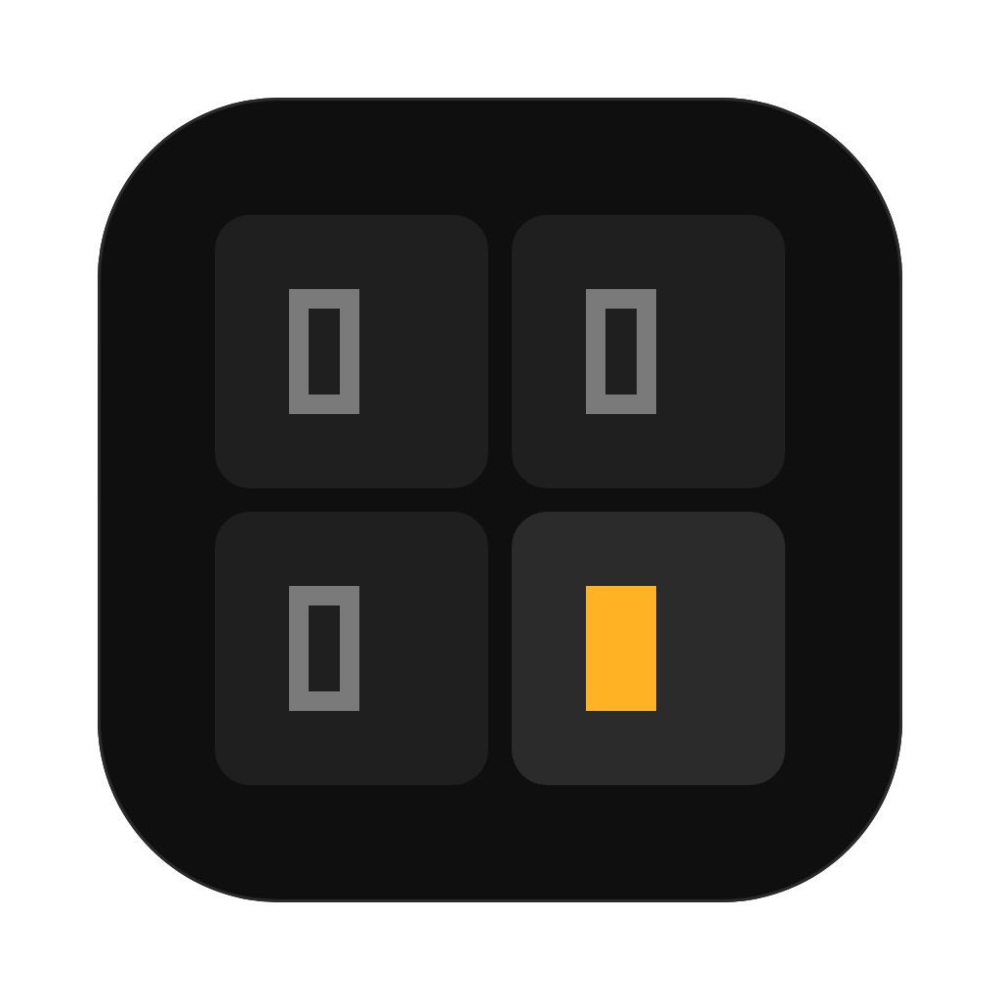

# Wavi

同时运行多个 Claude Code、Codex 的 macOS 终端。

每个 agent 仍在它自己的终端界面里工作，你也照常在里面输入和作答。Wavi 补上旁边的事：哪个 agent 在等你，每个 worktree 改了什么，怎样审阅后在本地合并回去。

v0.3.0 · 仅 macOS（Apple 芯片 / Intel）· 尚未经过 Apple 公证 · MIT 许可

[下载](https://github.com/meloer101/terminal-reborn/releases/latest) · [安装](#安装) · [更新记录](CHANGELOG.md) · [路线图](docs/ROADMAP.md) · [反馈](#反馈) · [English](#english)

## 功能

### 每个 agent 的状态

- **侧栏**按项目列出会话。每行有状态图形和文字、当前动作（如“编辑 auth.ts”“运行 pnpm test”）、最后一句回复和时间；等你处理时写“已等 3m”。状态从不只靠颜色区分。
- **总览**（⇧⌘A）跨项目按状态分组：等你处理、出错、待审阅、运行中、空闲、已退出。列表里可以原地展开某个会话的终端直接操作，也可以换成看板。
- agent 请求权限或提问时，会话变成“等你处理”，同时发系统通知、更新 Dock 角标；⌘J 跳到下一个需要你的会话。作答仍在 agent 自己的界面里完成。
- 会话标题用 agent 自己给对话起的名字，双击可以改名。

### Worktree：新建、审阅、合并、归档

- **新建**（⌘N）：选新 worktree 或当前目录、基于哪个分支、用 Claude Code / Codex / 普通终端。worktree 在后台创建，并按 `.worktreeinclude` 复制被 git 忽略的文件（如 `.env`）。
- **脚本与端口**：仓库里的 `.tr/settings.toml` 可以写 `setup`、`run`、`test`、`archive` 脚本。第一次运行和内容改动后，Wavi 先列出全部命令请你确认。每个工作目录分到 10 个端口，通过 `TR_PORT` 传给其中的每个终端。
- **审阅**：右侧栏“变更”按未提交 / 已提交分组显示 diff，统一或并排。在 diff 行上写评论，Wavi 把它们合成一条带代码引用的说明，放进 agent 的输入行。也可以点“让 agent 审阅”，Wavi 另起一个只读的审阅进程（`claude -p` / `codex exec`，用你自己的登录和额度），发现的问题按 P0–P3 变成同样的行内评论，你勾选后再发。
- **本地合并**（⇧⌘M）：先检查领先 / 落后、冲突和未提交改动，有 `test` 脚本时先跑它；然后选 squash、merge 或 rebase。合并在内存里完成，基线分支到最后一步才前移，失败时仓库保持原样。有冲突时可以把说明交给 agent 处理。
- **归档**：停掉会话、保存未提交的改动，把 worktree 从侧栏收起，文件夹不删。之后在 ⌘K 的“历史”里恢复，agent 接上原来的对话。

### 右侧栏

- **Git 图谱**：默认分支和所有 worktree 分支的走向，worktree 的标签上带着对应 agent 的状态，点击跳到那个会话。
- **浏览器**：每个 worktree 一个内置页面，终端里的链接默认在这里打开（⌘ 单击用系统浏览器）。会话监听的端口显示在侧栏和总览里，点一下就打开。
- **文件**：目录树、git 状态和只读预览。终端输出里的文件路径（如 `src/app.ts:42`）可以点开，直接定位到那一行。
- **Worktree**：项目的全部 worktree、各自的会话和未提交改动；已合并且没有会话的可以一键清理。

### context 与额度

- 会话头显示 context 用了多少、todo 进度，以及 Claude / Codex 的额度。context 以 agent 自己的自动压缩点为刻度；点开能看到最近几轮的曲线、每个额度窗口的进度，以及按当前速度大约何时用完。
- 额度用到 75%、90% 和用完时各提醒一次，可以在设置里关掉。
- 在 Wavi 的普通终端里自己敲的 `claude` / `codex` 也有这些数字。

### 终端

- 基于 xterm.js，WebGL 渲染。英文字体和中文字体分开设置，中文严格占两格；浅色 / 深色主题，字号、行高、连字可调。
- agent 由一个独立的守护进程托管：关窗口或 ⌘Q 之后 agent 继续运行，再打开时接回同一个进程和屏幕；⌥⌘Q 才结束所有会话。重启电脑后，你第一次打开某个会话时，Wavi 用 `--resume` 接上原来的对话。
- ⌘K 跳到任何会话、项目或操作；⌘F 在终端里搜索。

## Wavi 不会做的事

- **不需要账号。** Wavi 没有自己的服务器：不注册、不登录，没有云同步，没有遥测。它每天问一次 GitHub 有没有新版本，有就发一条通知，不会自动下载或安装；除此之外只在你的操作需要时运行 git 的网络命令（创建 worktree 前 `git fetch`，你勾选推送时 `git push`），走你自己的 git 配置。
- **不改你的 agent 配置，也不绕过它的 hook 信任。** hooks 在每次启动时通过命令行参数注入（Claude 用 `--settings`，Codex 用 `-c`），从不写 `~/.claude/settings.json` 或 `~/.codex/`。Codex 默认不运行未被信任的 hook；Wavi 不用 `--dangerously-bypass-hook-trust`，只按 Codex 自己算出的 hash 信任 Wavi 的这几条，仓库和插件里你没审过的 hook 照旧不会运行。
  - Claude 的“信任此文件夹”由你在终端里自己确认。Codex 启动时的目录信任确认由 Wavi 跳过：只在这一次启动里把当前目录标为信任，同样用 `-c`，不写文件。
  - 在 Wavi 的普通终端里，PATH 最前面有 `claude` / `codex` 的 shim：只在交互式运行时加上同样的参数，`-p`、`mcp`、`doctor`、`agents` 这类命令原样运行。
- **归档不用 `git stash`。** 未提交和未跟踪的改动存进这个仓库的私有 ref `refs/wavi/archive/<id>`，不写 stash 列表、分支、暂存区和 git config，所以不会碰到你或其他 worktree 的 stash。恢复后这个 ref 会被删掉。被 git 忽略的文件不保存。
- **不替你花 token。** 只有你点了写明会发什么的按钮，Wavi 才向 agent 发消息。行内评论、冲突说明、浏览器里的报错和 `/compact` 都只放进 agent 的输入行，由你看过后按回车发送。Wavi 也不会自己恢复会话：重启后的会话要等你打开它才 `--resume`。会自动花额度的功能（合并前、推送前或一轮结束后自动审阅）都在设置 · 自动化里，默认关闭。额度读数由 CLI 用你自己的登录向账号查询，不发模型请求。

## 安装

需要 macOS 13 或更高（Apple 芯片或 Intel），并已安装、登录 [Claude Code](https://docs.claude.com/en/docs/claude-code) 或 [Codex](https://github.com/openai/codex) 命令行。都没装也能当普通终端用。

1. 在 [Releases](https://github.com/meloer101/terminal-reborn/releases/latest) 下载 dmg：Apple 芯片选文件名带 `arm64` 的，Intel 选带 `x64` 的。
2. 打开 dmg，把 Wavi 拖进「应用程序」。
3. Wavi 还没有经过 Apple 公证，只有 ad-hoc 签名，macOS 会拦下从网上下载的这类应用。第一次打开前，在终端里运行一次：

   ```bash
   xattr -cr /Applications/Wavi.app
   ```

   它清掉应用上的扩展属性，其中包括下载时加上的隔离标记。也可以先双击打开一次，再到「系统设置 → 隐私与安全性」点「仍要打开」。完成公证后不再需要这一步。
4. 有新版本时 Wavi 会发一条通知，点开是发布页。下载新的 dmg 覆盖安装，再运行一次上面的命令。

## 反馈

- 遇到问题或想要某个功能，请[提交 issue](https://github.com/meloer101/terminal-reborn/issues/new/choose)，有中文模板。
- 报 bug 时附上 Wavi、macOS 和 agent 的版本最有用（`claude --version`、`codex --version`）。
<!-- TODO(author): 开启 GitHub Discussions、建好用户群后，在这里加上链接。 -->

## 已知限制

- 仅 macOS，尚未公证（见安装第 3 步）。
- 状态、通知和各项指标只适配了 Claude Code 和 Codex。其他 CLI 可以在普通终端会话里运行，但没有这些。
- Codex 的额度还没有在真实 ChatGPT 账号上验证过；用 API key 登录时 Codex 不提供额度，只显示 context。
- 还没有：PR / CI 状态、在图谱上右键合并、孤儿 worktree 自动回收。见[路线图](docs/ROADMAP.md)。

## 开发

需要 Node ≥ 22.12 和 macOS。

```bash
npm install
npm run dev          # 开发版，带热更新，用独立的 Wavi Dev 配置
npm run app:install  # 把链接到本仓库的 Wavi.app 装进「应用程序」
npm run build:watch  # 改代码后自动构建，已安装的 Wavi 随之刷新
npm run check        # typecheck + lint + 单元测试
npm run test:e2e     # 构建并运行 Electron 冒烟测试
npm run dist         # 打包 arm64 / x64 的 dmg 和 zip 到 release/
```

文档：[PRD（产品要做成什么样）](docs/PRD.md) · [路线图](docs/ROADMAP.md) · [参与贡献](CONTRIBUTING.md)。维护者发版流程见 [CONTRIBUTING](CONTRIBUTING.md#维护者发版)。

## License

[MIT](LICENSE)

---

## English

Wavi is a macOS terminal for running several Claude Code and Codex sessions at once. Each agent keeps its own TUI, and you type and answer in it as usual. Wavi adds what sits around it: which agent is waiting for you, what each worktree changed, and how to review it and merge it back locally.

v0.3.0 · macOS only (Apple silicon / Intel) · not notarized yet · MIT. The interface is in Chinese for now.

**What ships**

- A sidebar with each session's status (shape and text, never color alone), current action, last reply and wait time. An overview (⇧⌘A) groups every session by state, as a list or a board. Notifications, a Dock badge, and ⌘J to the next session that needs you.
- Worktrees end to end: ⌘N creates one in the background. Review its diff (unified or side by side) and send inline comments back to the agent, or start a read-only background review that turns its findings into comments. Merge locally (⇧⌘M) after pre-checks, with squash, merge or rebase and nothing left half-done on failure. Archive the worktree and restore it later.
- A right panel with a git graph that shows each worktree's agent status, a per-worktree browser for terminal links and dev-server ports, and a file tree with previews.
- Context, todo and plan-usage meters for Claude Code and Codex, also for a `claude` or `codex` you type into a plain Wavi terminal.
- Separate Latin and CJK fonts (CJK takes exactly two cells), light and dark themes.
- A PTY daemon keeps agents running after you close the window or quit with ⌘Q; ⌥⌘Q ends them.

**What Wavi does not do**

- No account, no server, no telemetry. Wavi checks GitHub for a new release once a day; otherwise it only goes online for git commands you trigger (fetch before creating a worktree, push when you ask for it).
- It never writes `~/.claude/settings.json` or `~/.codex/`: hooks are passed on each launch. It never bypasses the agent's hook trust: for Codex it trusts only its own hooks, pinned by hash, and never uses `--dangerously-bypass-hook-trust`.
- Archiving stores uncommitted work under `refs/wavi/archive/<id>`, not in `git stash`, so the stashes of other worktrees are never touched.
- It never sends anything to an agent or resumes one on its own. Comments, conflict notes and `/compact` go into the agent's input line for you to send; a restored session resumes when you open it; anything automatic lives in Settings · Automation and is off by default.

**Install**

Download the `arm64` (Apple silicon) or `x64` (Intel) dmg from [Releases](https://github.com/meloer101/terminal-reborn/releases/latest) and drag Wavi into Applications. The app is ad-hoc signed and not notarized yet, so macOS blocks it after download. Clear the quarantine flag once before the first launch (this step goes away after notarization):

```bash
xattr -cr /Applications/Wavi.app
```

Requires macOS 13 or later and the Claude Code and/or Codex CLI, signed in.

**Feedback**: [open an issue](https://github.com/meloer101/terminal-reborn/issues/new/choose). Development commands are listed [above](#开发).
