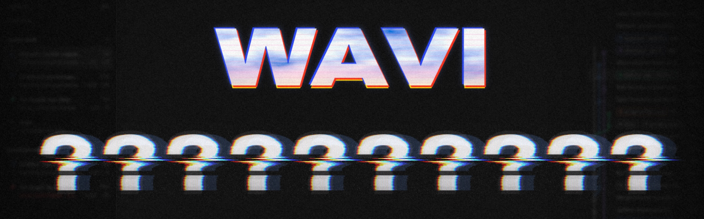
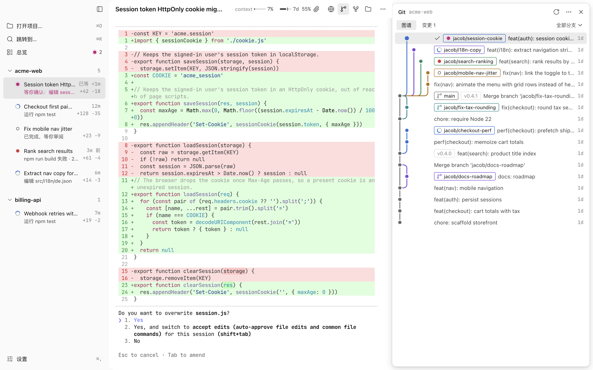
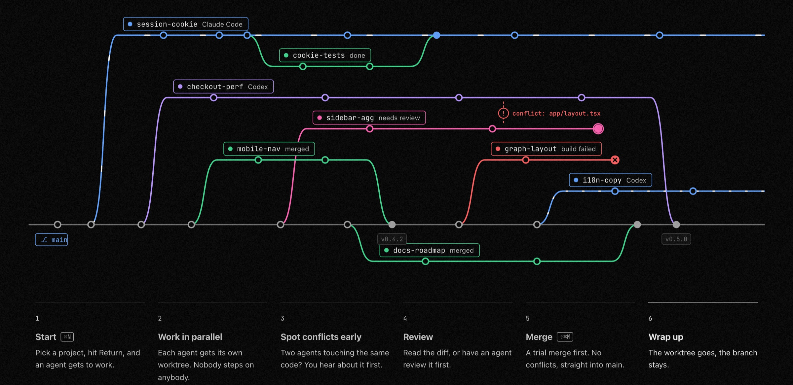
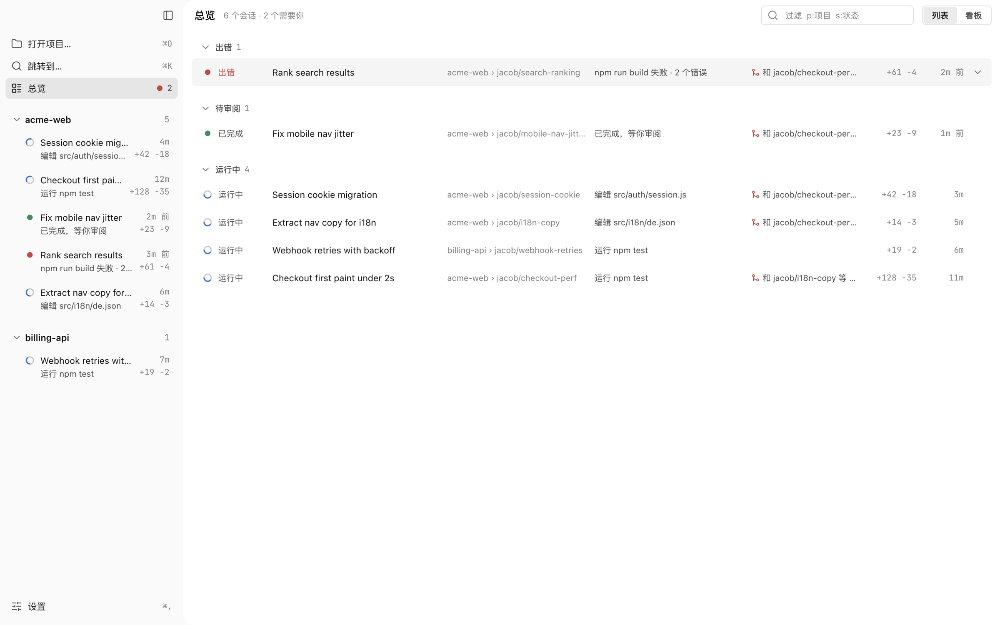
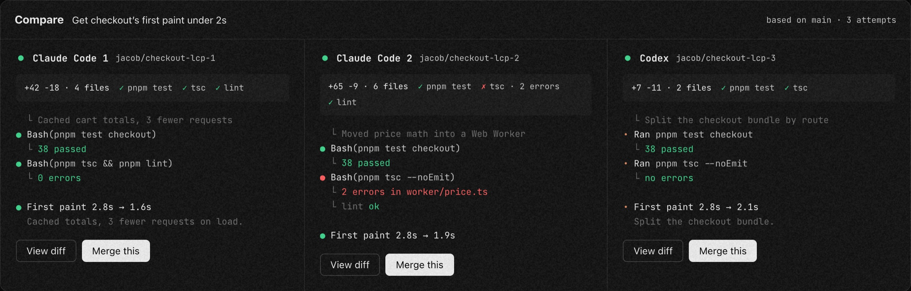
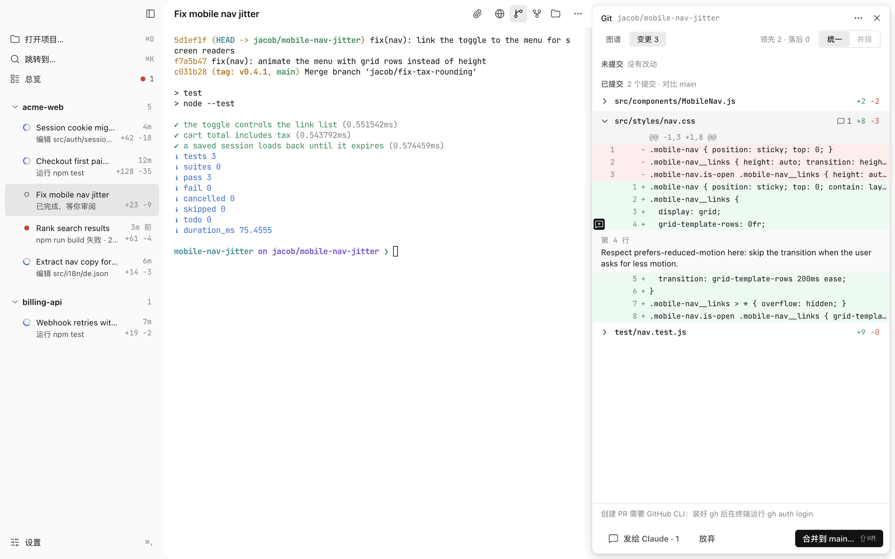
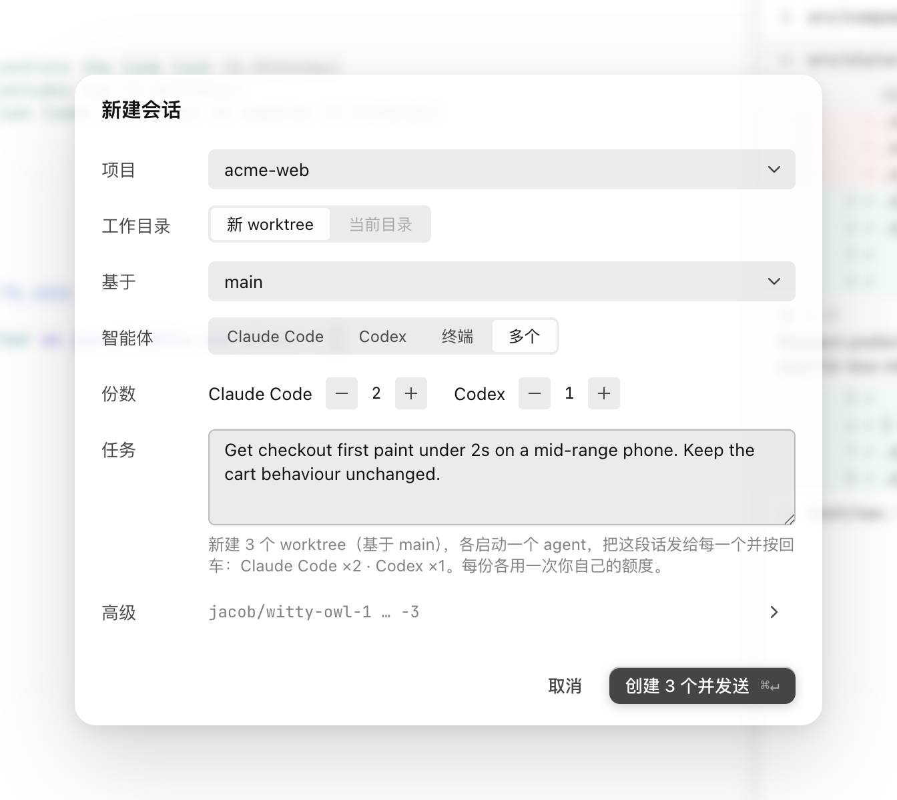
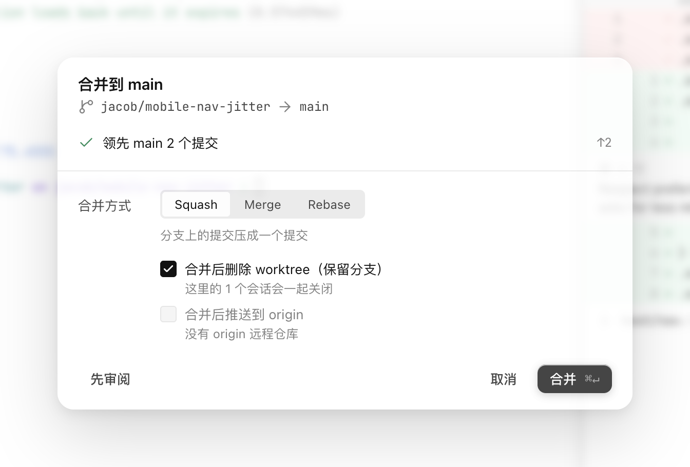
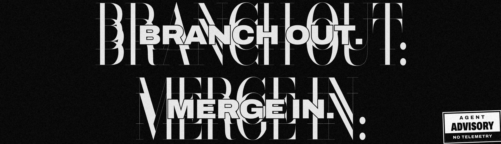

<p align="center">
  <a href="https://wavi-pi.vercel.app"></a>
</p>

<h3 align="center">One person, many threads.</h3>

<p align="center">
  A macOS terminal for running many Claude Code and Codex agents in parallel.<br>
  Each agent works in its own git worktree. Wavi tells you which one is waiting on you,<br>
  shows what each one changed, and merges the good work back locally.
</p>

<p align="center">
  <a href="https://github.com/meloer101/terminal-reborn/releases/latest"></a>
  
  
  
  <a href="LICENSE"></a>
</p>

<p align="center">
  <a href="https://github.com/meloer101/terminal-reborn/releases/latest"><b>Download for macOS</b></a>
  &nbsp;·&nbsp; <a href="https://wavi-pi.vercel.app">Website</a>
  &nbsp;·&nbsp; <a href="CHANGELOG.md">Changelog</a>
  &nbsp;·&nbsp; <a href="docs/ROADMAP.md">Roadmap</a>
  &nbsp;·&nbsp; <a href="README.zh-CN.md">简体中文</a>
</p>

<br>

<picture>
  <source media="(prefers-color-scheme: dark)" srcset="docs/assets/readme/hero-dark.png">
  
</picture>

<p align="center"><sub>A live Claude Code session asks before it overwrites a file. Its row in the sidebar turns to <i>waiting</i>, and the git graph tags every worktree branch with its agent's status. The interface is in Chinese for now.</sub></p>

## Why Wavi

Running one coding agent is easy. Running five means five terminals, five branches stepping on each other, and a permission prompt that has been waiting for ten minutes in a tab you forgot about.

Wavi keeps each agent in its own terminal user interface (TUI), exactly as the CLI ships it: you type and answer there as usual. Around the agents, Wavi adds the work of a lead: who needs you right now, what each worktree changed, whether the tests passed, and how to merge the best result back without breaking `main`.

## How it works



## Features

### Know who's waiting, at a glance

Every session shows its status as a shape and a word, never color alone, along with its current action ("editing auth.ts", "running pnpm test") and how long it has waited. The overview (<kbd>⇧⌘A</kbd>) groups every session across projects by what it needs: waiting on you, error, ready for review, running, idle. Notifications and a Dock badge tell you when an agent asks for permission, and <kbd>⌘J</kbd> jumps to the next one.

<picture>
  <source media="(prefers-color-scheme: dark)" srcset="docs/assets/readme/overview-dark.png">
  
</picture>

### One worktree per agent, or several agents per task

<kbd>⌘N</kbd> creates a worktree in the background, copies ignored files like `.env` per `.worktreeinclude`, and starts Claude Code, Codex or a plain shell in it. Choose *several* to hand one task to two to four agents at once, Claude Code and Codex mixed. Each attempt gets its own worktree from the same base. Then line them up side by side and merge the best one.



### Review the diff, talk back on the lines

The changes panel shows uncommitted and committed work against the base branch, unified or side by side. Comment on any line, and Wavi turns your comments into one note with code references in the agent's input line. Or ask for a read-only review by an agent, optionally the other vendor (Codex reviews Claude's work and the other way round). Its findings come back as the same inline comments, ranked P0–P3.

<picture>
  <source media="(prefers-color-scheme: dark)" srcset="docs/assets/readme/review-dark.png">
  
</picture>

### Merge locally, and nothing is left half-done

<kbd>⇧⌘M</kbd> checks ahead and behind counts, conflicts and uncommitted work first, and runs your `test` script if there is one. Then it squashes, merges or rebases. The merge happens in memory, and the base branch moves only at the last step, so a failure leaves the repository exactly as it was. In the background, a conflict radar compares active worktrees with each other and with the base, and warns you before two agents collide.

<table>
  <tr>
    <td width="50%" valign="top">
      <picture>
        <source media="(prefers-color-scheme: dark)" srcset="docs/assets/readme/new-session-dark.png">
        
      </picture>
      <p align="center"><sub><kbd>⌘N</kbd> one task, three worktrees: two Claude Code, one Codex</sub></p>
    </td>
    <td width="50%" valign="top">
      <picture>
        <source media="(prefers-color-scheme: dark)" srcset="docs/assets/readme/merge-dark.png">
        
      </picture>
      <p align="center"><sub><kbd>⇧⌘M</kbd> merge after the pre-checks; the branch stays</sub></p>
    </td>
  </tr>
</table>

**Also in the loop**

- **Pull requests**: create a PR with this turn's checks and review as evidence, bring unresolved PR comments back onto the lines they're about, and merge through GitHub, pinned to the commit you reviewed.
- **Turn checks**: which tests, lint and type checks the agent ran this turn, and whether they passed. Read from hooks; no tokens spent.
- **Archive**: stop the session, keep uncommitted work in a private ref, fold the worktree away, and restore it later with the conversation intact.

### And the rest of a proper terminal

- **Agents outlive the window.** A background daemon owns every PTY. Close the window or quit with <kbd>⌘Q</kbd>, and agents keep running; reopen Wavi and you're back on the same process and screen. After a reboot, a session resumes its conversation with `--resume` when you open it.
- **Agents hand work to each other.** An agent can start new Claude Code or Codex sessions, each in its own worktree with its own task, and gets their results back. Every batch waits for your confirmation first.
- **Context and plan usage.** The session header shows context used against the agent's own auto-compaction point, todo progress and your Claude / Codex plan windows, with a warning at 75%, 90% and 100%.
- **Right panel.** A git graph with each worktree's agent status, a built-in browser per worktree for dev servers and terminal links, and a file tree with previews. Click `src/app.ts:42` in terminal output to jump to that line.
- **Splits and windows.** Show two to four sessions side by side, or drag one out into its own window. Layouts come back after a restart.
- **A terminal that gets CJK right.** xterm.js with WebGL rendering. Separate Latin and CJK fonts, with CJK at exactly two cells. Light and dark themes, <kbd>⌘K</kbd> to jump anywhere, <kbd>⌘F</kbd> to search.

## Private by default

- **No account, no server, no telemetry.** Wavi checks GitHub for a new release once a day. Otherwise it goes online only for git commands you trigger, using your own git config.
- **It never touches your agent config.** Hooks are passed on each launch (`--settings` for Claude, `-c` for Codex), never written to `~/.claude/settings.json` or `~/.codex/`. Wavi never bypasses Codex's hook trust: it trusts only its own hooks, pinned by hash.
- **It never spends tokens on its own.** Comments, conflict notes and `/compact` go into the agent's input line, and you press Return. Anything automatic, like review before merge, lives in Settings · Automation and is off by default.
- **No `git stash`.** Archived work is stored under `refs/wavi/archive/<id>`, so the stash lists of your other worktrees are never touched.

## Install

1. Download the dmg from [Releases](https://github.com/meloer101/terminal-reborn/releases/latest): `arm64` for Apple silicon, `x64` for Intel.
2. Open it and drag Wavi into Applications. Builds are signed with a Developer ID and notarized by Apple.
3. Have [Claude Code](https://docs.claude.com/en/docs/claude-code) and/or [Codex](https://github.com/openai/codex) installed and signed in. Without either, Wavi still works as a terminal.

Requires macOS 13 or later. Wavi tells you when a new version is out; download it and replace the app.

## Supported agents

| | Status and notifications | Context and plan usage | Review, dispatch, resume |
|---|:---:|:---:|:---:|
| **Claude Code** | ✓ | ✓ | ✓ |
| **Codex** | ✓ | ✓ <sup>1</sup> | ✓ |
| Any other CLI | runs in a plain terminal session | – | – |

<sup>1</sup> Codex plan usage has not been verified on a real ChatGPT account yet; with an API key Codex reports context only.

## FAQ

<details>
<summary><b>How is this different from tmux or terminal tabs?</b></summary>
<br>
Tabs show you terminals. Wavi knows what the agent inside each one is doing: it reads the agent's own hooks to tell waiting from running from done, and it owns the git side, including worktrees, diffs, review, merge and archive. You stop polling tabs.
</details>

<details>
<summary><b>Does Wavi send my code anywhere?</b></summary>
<br>
No. Wavi has no server. Your code goes only where your agents and your git remotes already send it. Plan usage is read by the CLI from your own account, without model requests.
</details>

<details>
<summary><b>Will it change my Claude Code or Codex setup?</b></summary>
<br>
No. Everything Wavi needs is passed on the command line for each launch. Run <code>claude</code> or <code>codex</code> outside Wavi and nothing is different.
</details>

<details>
<summary><b>Why is the interface in Chinese?</b></summary>
<br>
Wavi started with Chinese developers in mind, and the interface is in Chinese for now. The agents, your prompts and your code are unaffected. The website and these docs are in English.
</details>

<details>
<summary><b>What doesn't it do yet?</b></summary>
<br>
macOS only. Status, notifications and meters are built for Claude Code and Codex. See the <a href="docs/ROADMAP.md">roadmap</a> for what's next.
</details>

## Development

Requires Node ≥ 22.12 and macOS.

```bash
npm install
npm run dev          # dev build with hot reload, in its own "Wavi Dev" profile
npm run check        # typecheck + lint + unit tests
npm run test:e2e     # build and run the Electron end-to-end tests
npm run dist         # package arm64 / x64 dmg and zip into release/
```

The product spec is [docs/PRD.md](docs/PRD.md), progress is in [docs/ROADMAP.md](docs/ROADMAP.md), and [CONTRIBUTING.md](CONTRIBUTING.md) covers the rest. Found a bug or want a feature? [Open an issue](https://github.com/meloer101/terminal-reborn/issues/new/choose). Including your Wavi, macOS, `claude --version` and `codex --version` helps the most.

## License

[MIT](LICENSE). Third-party code and assets are listed in [THIRD_PARTY_NOTICES.md](THIRD_PARTY_NOTICES.md).

<br>

<p align="center">
  
</p>
